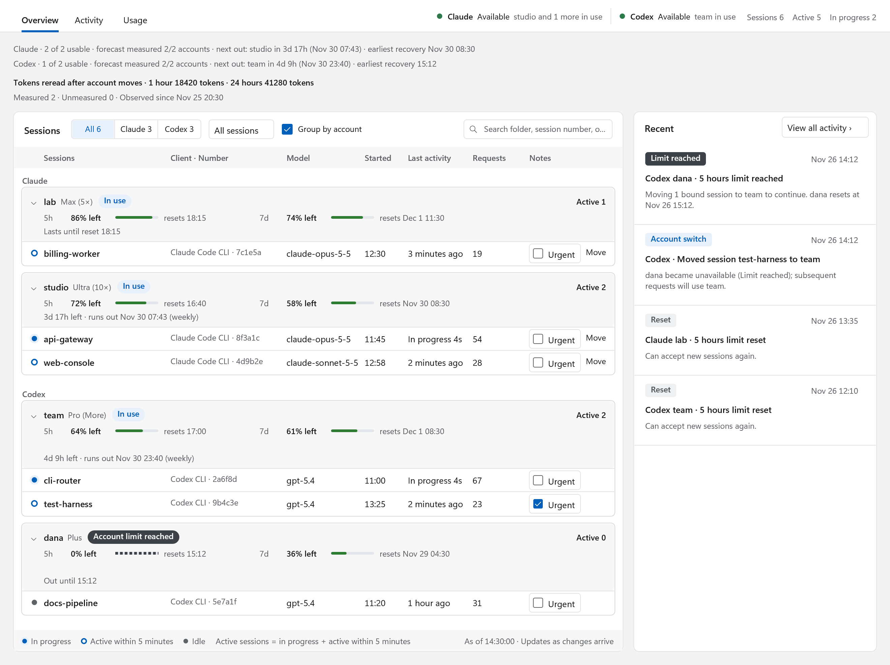
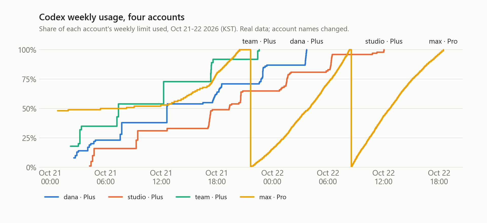
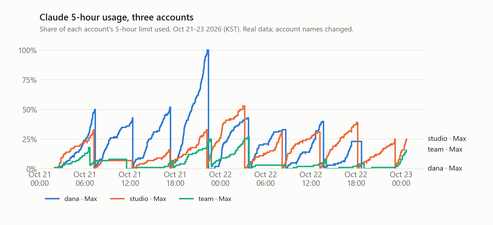
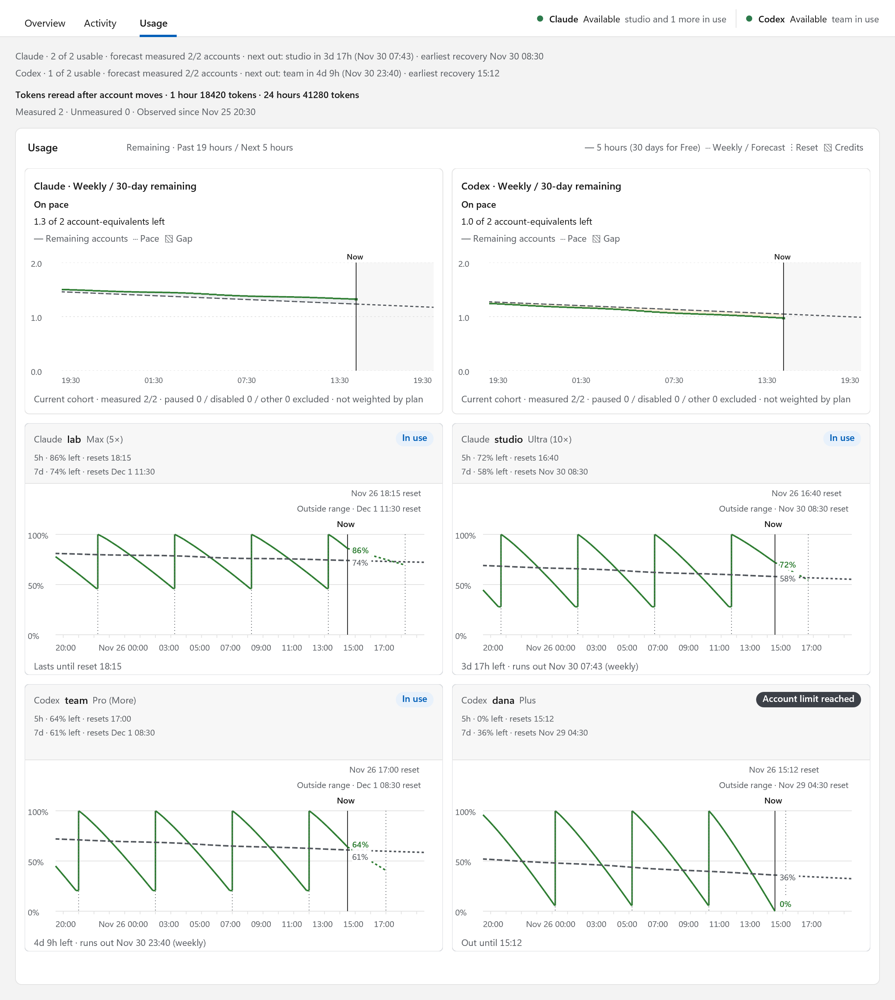
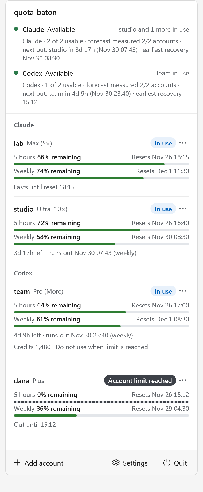

# quota-baton

**Run Claude Code and Codex CLI across multiple subscription accounts without breaking prompt caches.**

quota-baton is a local proxy (Windows tray + dashboard, and a headless Linux systemd core) that routes each session to one of your own Claude or ChatGPT subscription accounts and keeps it there until that account can no longer serve it.

<picture>
  <source media="(prefers-color-scheme: dark)" srcset="docs/assets/ui-overview-dark.png">
  
</picture>

Measured over one week of daily use (Oct 16–22, 2026): **116,611** relayed requests across **720** sessions and **12** accounts, **96.5%** Codex input served from cache, and only **45** account moves.

## Why quota-baton

- **Sticky session affinity.** Usage thresholds only pick where a *new* session starts. A running session stays on its account until that account hits a quota limit, gets revoked, or is paused—so prompt caches are not thrown away to chase a slightly emptier account.
- **Byte-for-byte relay.** Request and response bodies from the official Claude Code and Codex CLI pass through untouched. Only credential and routing headers change; there is no client impersonation, tool injection, or forced flags.
- **Predictable memory.** quota-baton never stores conversation history. Each in-flight request keeps at most one bounded copy of its body until the first response byte arrives, then releases it immediately.
- **Live quota and burn-rate forecasts.** Usage comes from response headers and each provider's usage endpoint. Every account shows remaining capacity and an exhaustion forecast (for example, `5h 47m left · runs out 11:27 (weekly)`), alongside a provider-wide weekly pace chart.
- **Smart limit handling.** When a 5-hour limit resets within the prompt-cache lifetime, a session waits on its own account instead of re-sending its full context elsewhere. Model-scoped Claude limits stay scoped to that model while other models keep running. Rate-limited requests pace smoothly instead of failing fast with synthesized 429s, and accounts used outside quota-baton are detected automatically.
- **Safe coexistence.** `wire` creates dedicated `claude-qb` and `codex-qb` launchers alongside your existing setup. Plain `claude` and `codex` stay untouched as a direct fallback.

## How routing works

`claude-qb` and `codex-qb` route official CLI traffic to the local core on `127.0.0.1:10200`. When a new session starts, the core checks each account's 5-hour and weekly windows and picks the eligible account with the most headroom. An account that just accepted a new session is held back from another burst launch until fresh usage data arrives, preventing sessions from piling onto one account.

Once bound, the session stays on that account. If the account runs out of quota, loses authorization, or is paused, the failover happens cleanly before the first byte of the next response reaches the client. Paid credits stay off unless you explicitly allow them per account, and `quota-baton serve --takeover` upgrades the core in place with **0 dropped connections** (verified across 1,890 consecutive 10 ms probes).

Four Codex accounts over two days—as each Plus account hits its weekly limit, new work flows smoothly to the next:

<picture>
  <source media="(prefers-color-scheme: dark)" srcset="docs/assets/codex-weekly-dark.png">
  
</picture>

Three Claude accounts over two days, each filling and resetting its 5-hour rolling window on its own schedule:

<picture>
  <source media="(prefers-color-scheme: dark)" srcset="docs/assets/claude-5h-dark.png">
  
</picture>

Both charts are plotted from real local usage history with account names anonymized. See the [architecture guide](docs/architecture.md) for the full routing and memory model.

## Dashboard and tray

Double-click the Windows tray icon to open the native dashboard. The **Overview** tab (shown at the top) groups live sessions by account with remaining quota, exhaustion forecasts, and recent events.

The **Usage** tab pairs a provider-wide weekly pace chart with per-account 24-hour timelines (19 hours back to 5 hours ahead) so upcoming resets and projections stay visible at a glance:

<picture>
  <source media="(prefers-color-scheme: dark)" srcset="docs/assets/ui-usage-dark.png">
  
</picture>

The **Tray flyout** gives one-click access to account status, manual usage refreshes, pause/resume controls, paid-credit permissions, and manual hold release:

<picture>
  <source media="(prefers-color-scheme: dark)" srcset="docs/assets/ui-flyout-dark.png">
  
</picture>

## Quick start (Windows)

Run the installer in PowerShell:

```powershell
irm https://raw.githubusercontent.com/MeroZemory/quota-baton/main/install.ps1 | iex
```

The installer downloads the latest verified release (SHA-256 checked), installs to `%LOCALAPPDATA%\Programs\quota-baton`, previews the `claude-qb` and `codex-qb` launchers before applying changes, and registers the tray app at login. Running it again upgrades in place without dropping open sessions. To remove everything later, run `uninstall.ps1` (add `-RemoveData` only if you also want to delete saved accounts).

Next, log in to your accounts (add `--no-browser` on a headless machine):

```powershell
quota-baton accounts login claude
quota-baton accounts login codex
```

Start your CLI sessions with `claude-qb` or `codex-qb`.

<details><summary>Manual installation or importing an existing login</summary>

1. Download the release archive from [Releases](https://github.com/MeroZemory/quota-baton/releases) or build from source with `cargo build --release --workspace` (Rust 1.93+, MSVC toolchain on Windows).
2. Preview and apply client wiring with `quota-baton wire` then `quota-baton wire --apply` (remove with `quota-baton unwire --apply`).
3. Launch `quota-baton-tray.exe`; it manages the local core automatically.
4. To take over an existing Codex or Claude home instead of logging in again, run `quota-baton accounts takeover codex <home>`. quota-baton takes ownership of token refreshes and renames the original credential file so both tools never compete on a single-use refresh token.

</details>

## Linux headless core

On Linux (`x86_64`, Ubuntu 24.04+ with systemd 255), quota-baton runs as a hardened headless systemd service serving local containers over per-box Unix sockets and scoped keys, with browserless OAuth login and zero-downtime `serve --takeover` upgrades. See [docs/linux.md](docs/linux.md) for installation and container wiring.

## Everyday commands

| Command | Purpose |
|---|---|
| `quota-baton status` | Core health, ports, and per-account quota summary |
| `quota-baton accounts list --detail` | Accounts, usage windows, and burn-rate forecasts |
| `quota-baton accounts refresh-usage <id>` | Force a fresh usage check for one account |
| `quota-baton accounts pause <id>` / `resume <id>` | Pause or resume placing new sessions on an account |
| `quota-baton accounts release-hold <id>` | Clear a quota hold manually and probe on the next request |
| `quota-baton routing ...` | Set per-project or per-session policy (`strict`, `recover`, `rebalance`) |
| `codex-qb resume <id>` | Import an existing Codex conversation via hardlinks |
| `codex-qb --account <id>` | Pin a launch to a specific account and its model catalog |
| `codex-qb --images` | Launch a Codex session on an image-capable account |
| `codex-qb --urgent` / `claude-qb --urgent` | Fail over immediately at a 5-hour limit instead of waiting |

To define a short launcher alias such as `codex-ab` for a specific account, add `short = "ab"` under that account in `config.toml` and re-run `quota-baton wire --apply`.

## Configuration and limits

- **Local-only by default.** Configuration lives in `%LOCALAPPDATA%\quota-baton\config.toml` (override with `QB_HOME`). The core binds strictly to `127.0.0.1` (port `10200` for client traffic, `10201` for the authenticated admin API) and encrypts tokens with Windows DPAPI (or systemd credentials on Linux).
- **Subscription accounts only.** Supports Claude subscriptions (Claude Code) and ChatGPT subscriptions (Codex CLI). Pay-per-token API keys are not mixed into subscription pools.
- **Platform split.** The native tray, dashboard, and `*-qb` launchers are Windows 11 (`x64`) only; Linux runs the headless core and CLI.
- **Language.** The tray and dashboard default to Korean and switch to English with `[ui] language = "en"` in `config.toml`.
- **Cache cost on moves.** Prompt caches belong to a single account, so any unavoidable move pays one uncached turn; Codex also drops hidden reasoning state from the previous account.
- **Forecasts are estimates.** Exhaustion times are computed from recent local observations, not provider guarantees.
- **Your accounts, your terms.** Use quota-baton only with accounts you own, in compliance with each provider's terms.

## Documentation and development

- [Architecture](docs/architecture.md): system structure, memory bounds, routing, and verification
- [Behaviour contract](docs/contract.md): normative rules tested by the suite
- [Decision log](docs/decisions.md): design choices and rationale
- [Linux guide](docs/linux.md): headless systemd core and container setup
- [User guide (Korean)](docs/user-guide.md)

Build and verify from source (set `QB_HOME` to a scratch directory when running a development core):

```powershell
cargo fmt --check
cargo clippy --workspace --all-targets -- -D warnings
cargo test --workspace
```

## License

Dual-licensed under [MIT](LICENSE-MIT) or [Apache-2.0](LICENSE-APACHE), at your option. The vendored `vendor/tungstenite` retains its own license.
