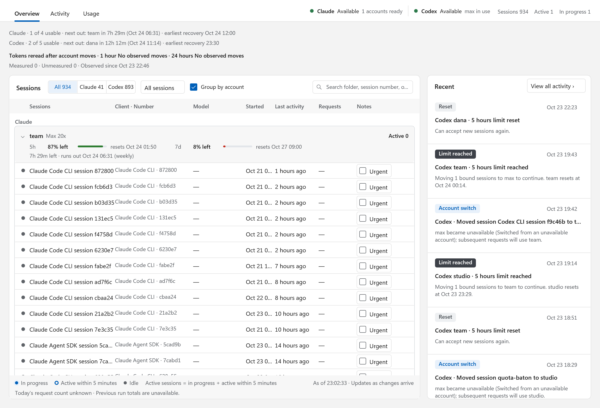
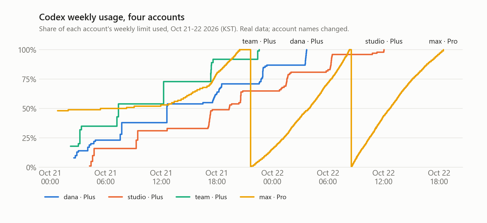
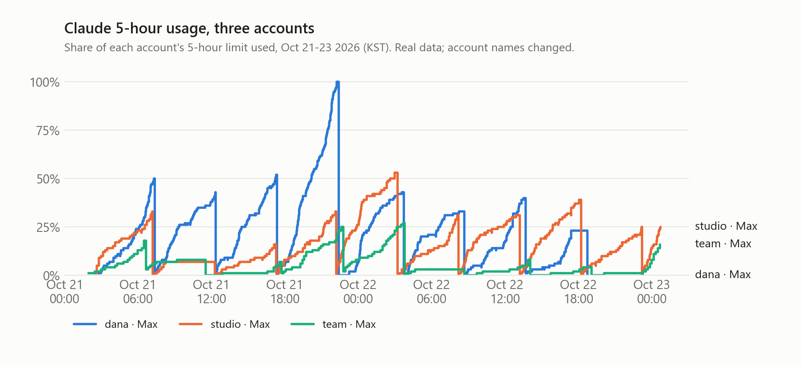
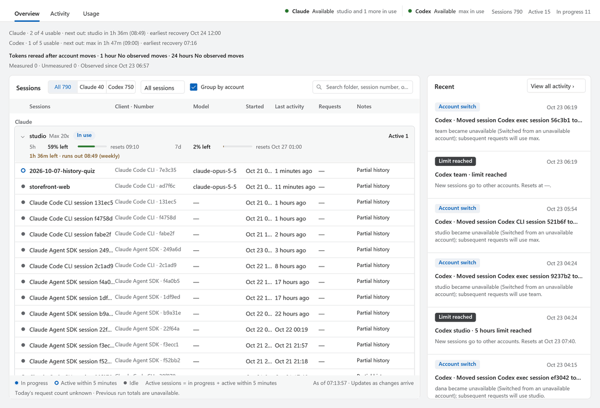
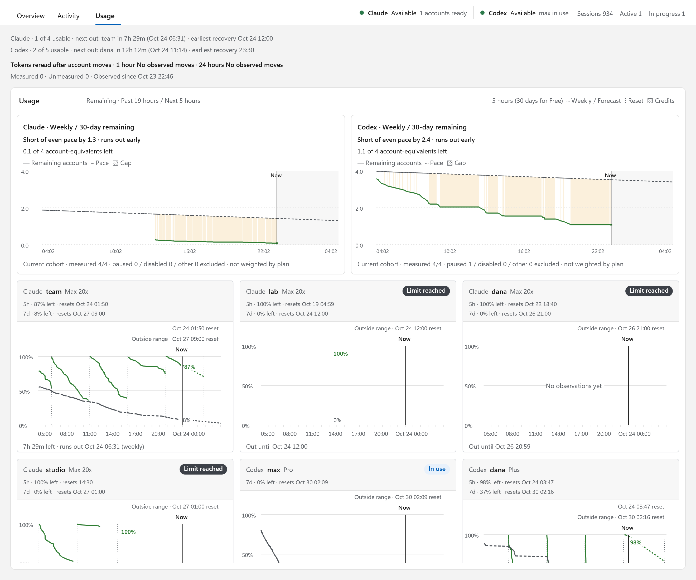
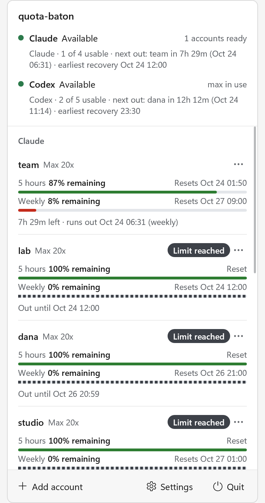

# quota-baton

quota-baton is a local proxy and tray app for Windows that runs Claude Code and Codex CLI sessions across several of your own subscription accounts.

**Each session stays on one account, so its prompt cache keeps working.** It moves only when that account can no longer serve it, and the move happens before the first byte of a response reaches the client.

<picture>
  <source media="(prefers-color-scheme: dark)" srcset="docs/assets/ui-overview-dark.png">
  
</picture>

One week on the author's machine (Oct 16 to Oct 22, 2026):

| Requests relayed | Sessions | Accounts | Codex input served from cache | Account moves |
|---:|---:|---:|---:|---:|
| 116,611 | 720 | 12 | 96.5% | 45 |

## What sets it apart

1. **Sessions keep their account.** Usage thresholds only decide where a *new* session goes. A running session changes account only when its account is out of weekly quota, logged out or paused (or at a 5-hour limit, if you marked it urgent), so its prompt cache is not thrown away to chase a slightly emptier account.
2. **It knows how much is left, and when it will run out.** Usage comes from response headers and from each provider's usage endpoint. Every account shows one line such as `5h 47m left · runs out 11:27 (weekly)`, and each provider gets a summary line and a weekly chart against an even-pace line.
3. **It does not touch what your client sends.** Request and response bodies from the real Claude Code and Codex CLI are relayed byte for byte; only the headers that carry credentials and routing are replaced. There is no client impersonation, no injected tools and no forced flags.
4. **It stays small.** quota-baton never stores conversations. It keeps one copy of each request body only until the response starts, so memory does not grow with conversation length or with the number of idle connections.
5. **It does not burn an account to dodge a short limit.** At a 5-hour limit a session waits on its own account for the reset instead of re-sending its whole context to another account. Mark a session urgent and it moves instead. Accounts you also use outside quota-baton are detected from their usage and left alone.
6. **It installs next to your setup, not over it.** `wire` adds `codex-qb` and `claude-qb`; plain `codex` and `claude` keep working exactly as before, as a fallback if the proxy is down.

## Problems it fixes

Before writing quota-baton, the author ran two popular multi-account proxies on this machine for daily work. These are the failures we traced in their logs and code, and what quota-baton does instead.

| What went wrong | What quota-baton does |
|---|---|
| Memory grew to 3.6-7 GB. One proxy kept a full transcript for every open connection; the other stalled all traffic. | Stores no conversation history. Each in-flight request holds at most one copy of its body, released when the response starts. |
| A live conversation bounced between accounts 407 times, because limits were re-checked on every turn. | Limits only steer new sessions. A running session moves only when its account cannot serve it. |
| Accounts that had been logged out stayed in rotation for days, because health was judged from the token's expiry time. | Health follows the provider's own error codes. A login is marked for re-login as soon as the provider reports it revoked. |
| A single-use refresh token was retried three times after the provider had rejected it. | Refresh errors are typed. A terminal error is never retried, and only one refresh per account runs at a time. |
| One 404 put a model on a 12-hour cooldown. | A 404 never changes an account's state. |
| Rotation happened only after a 429, and paid credits were spent without asking. | Usage drives the choice of account before any limit is hit. Paid credits are off until you turn them on per account. |
| The proxy answered rate-limited requests with an instant 429, and clients gave up; dozens of sessions sat stopped for hours. | A rate-limited request waits up to 60 seconds and is then sent once; the provider's own answer is passed through. quota-baton never makes up a 429. |
| Subscription logins and pay-per-token API keys shared one pool, and large sessions quietly moved to a paid key. | Supports subscription logins only. API keys cannot be added. |
| Request bodies from the real clients were rewritten through one translation path. | Bodies pass through unchanged. |
| One self-updating process carried all traffic, with a chain of launcher scripts and no status outside a web page. | A separate core and tray. The core upgrades in place (`serve --takeover`); status is in the tray, a native dashboard and the CLI. |

## How it works

`claude-qb` and `codex-qb` point Claude Code and Codex CLI at the core on 127.0.0.1. The core reads each account's 5-hour and weekly usage and gives every new session the account with the most room. An account that has just taken a session gets no other new session until fresh usage data arrives, so a burst of launches does not pile onto one account. From then on the session keeps that account. When the account runs out of weekly quota, gets logged out or is paused, the next request of that session goes to another account. At a 5-hour limit the session waits for the reset on the same account, unless it is marked urgent.

This is what that looked like for four Codex accounts over two days. As each Plus account reached its weekly limit, new work went to the next one:

<picture>
  <source media="(prefers-color-scheme: dark)" srcset="docs/assets/codex-weekly-dark.png">
  
</picture>

And for three Claude accounts, whose 5-hour windows fill and reset on their own schedules:

<picture>
  <source media="(prefers-color-scheme: dark)" srcset="docs/assets/claude-5h-dark.png">
  
</picture>

Both charts are drawn from quota-baton's own usage history on the author's machine. Only the account names were changed. The [architecture document](docs/architecture.md) covers the components and the rules in detail.

## Codex extras

- `codex-qb resume <id>` brings an existing Codex conversation from another Codex home into quota-baton. The rollout files are hardlinked rather than copied, and you confirm by typing `move`.
- `codex-qb --account <id>` prefers one account for a launch and shows that account's own model list in the picker.
- `codex-qb --images` starts a session with Codex's image tool, routed to an account that allows it.

## Upgrades without dropping sessions

`quota-baton serve --takeover` hands the listener to a new binary while the old one finishes its open streams. During one upgrade, a probe connecting every 10 ms for 25 seconds saw **0 refused connections out of 1,890**.

## Requirements

- Windows 11. Tested on build 26200; Windows 10 is untested.
- Claude Code and/or Codex CLI. Moving existing Codex conversations requires Codex CLI 0.163.0.
- Prebuilt x64 binaries are on the [Releases](https://github.com/MeroZemory/quota-baton/releases) page. Building from source needs Rust 1.93 with the MSVC toolchain.

## Setup

1. Download the zip from [Releases](https://github.com/MeroZemory/quota-baton/releases) and unpack it, or build it yourself. `quota-baton.exe` is the core and CLI; `quota-baton-tray.exe` is the tray app.

   ```powershell
   cargo build --release --workspace
   ```

2. Start the core. The tray can also start it and restart it if it exits.

   ```powershell
   quota-baton serve
   ```

3. Log in to each account. This opens the browser for OAuth.

   ```powershell
   quota-baton accounts login claude
   quota-baton accounts login codex
   ```

4. Create the `codex-qb` and `claude-qb` commands. Run it once without `--apply` to see the exact changes first.

   ```powershell
   quota-baton wire --codex-mode dedicated --claude-mode dedicated --apply
   ```

Start sessions with `codex-qb` or `claude-qb`. `quota-baton unwire --apply` removes everything `wire` created.

Accounts already logged in through another app's Codex or Claude home can be taken over with `quota-baton accounts takeover codex <home>`. quota-baton then owns the refresh token, and the original credential file is renamed so the two apps never refresh the same token.

## The dashboard

Double-click the tray icon to open it.



<picture>
  <source media="(prefers-color-scheme: dark)" srcset="docs/assets/ui-usage-dark.png">
  
</picture>

| Tab | Shows |
|---|---|
| Overview | Sessions grouped by account: model, last activity, requests today, and each account's forecast |
| Usage | One weekly chart per provider against an even-pace line, then each account from 19 hours ago to 5 hours ahead, so the next 5-hour reset is always on the chart |
| Events | Every account change and limit, with the reason |

The tray flyout shows the same accounts in a smaller view, with pause, credits and re-login actions.

<picture>
  <source media="(prefers-color-scheme: dark)" srcset="docs/assets/ui-flyout-dark.png">
  
</picture>

## Commands

| Command | What it does |
|---|---|
| `quota-baton status` | Core, ports and account summary |
| `quota-baton accounts list` | Accounts, usage windows and exhaustion forecasts |
| `quota-baton accounts pause <id>` | Stop placing sessions on an account |
| `quota-baton accounts release-hold <id>` | Clear a quota hold after you have checked the account |
| `quota-baton routing ...` | Per-project or per-session policy: `strict`, `recover` or `rebalance` |
| `codex-qb resume <id>` | Bring a Codex conversation from another home into quota-baton |
| `codex-qb --account <id>` | Prefer one account for this launch |
| `codex-qb --images` | New session with the image tool |
| `codex-qb --urgent`, `claude-qb --urgent` | Start a session that moves to another account at a 5-hour limit instead of waiting |
| `quota-baton sessions urgent <id> on\|off` | Change that for a running session (also a toggle in the dashboard) |

For a two-letter shortcut such as `codex-ab` (= `codex-qb --account <id>`), set `short = "ab"` under that account in `config.toml` and run `wire` again.

## Configuration

Settings live in `%LOCALAPPDATA%\quota-baton\config.toml`; set `QB_HOME` to use another folder. The core listens on **127.0.0.1 only**: port 10200 for client traffic and 10201 for the admin API, each with its own key. Tokens are stored with DPAPI in the same folder.

## Limits

- **Windows only.** The core is portable Rust, but the tray, credential storage and launchers are Windows-specific.
- **Two providers.** Claude subscriptions (Claude Code) and ChatGPT subscriptions (Codex CLI).
- **A move costs one uncached turn.** Prompt caches belong to an account and cannot follow a session. Codex also drops hidden reasoning from the old account.
- **Korean by default.** The tray and dashboard switch to English with `[ui] language = "en"` in `config.toml`. Most CLI messages are still Korean.
- **Waiting has a limit.** A session waits only while its client keeps the request open; after that it shows the provider's limit message and you resume it yourself. Automatic resume after long waits is not finished yet.
- **Forecasts are estimates** from recent usage, not figures from the provider.
- **Your accounts, your terms.** Use it only with accounts you own, and check each provider's terms for your plan.

## Documentation

- [Architecture](docs/architecture.md): components, memory bounds, routing and verification
- [Behaviour contract](docs/contract.md): the rules the code is tested against
- [Decision log](docs/decisions.md): what was decided, why, and what was rejected
- [User guide (Korean)](docs/user-guide.md)

## Development

```powershell
cargo fmt --check
cargo clippy --workspace --all-targets -- -D warnings
cargo test --workspace
```

Set `QB_HOME` to a scratch folder when you run a development core, so it never touches your real accounts.

## License

MIT or Apache-2.0, at your option. See [LICENSE-MIT](LICENSE-MIT) and [LICENSE-APACHE](LICENSE-APACHE). The vendored `vendor/tungstenite` keeps its own licenses.
